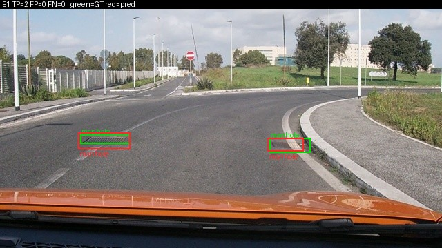
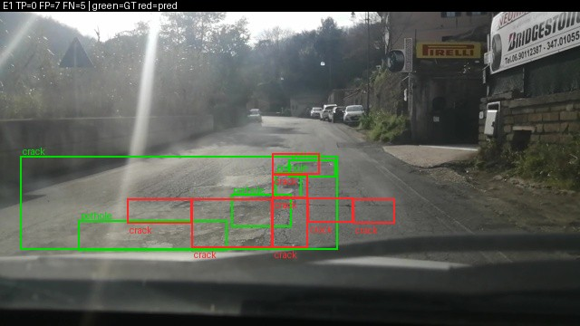
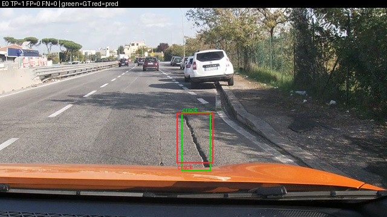
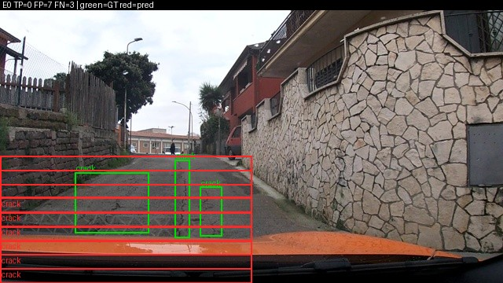
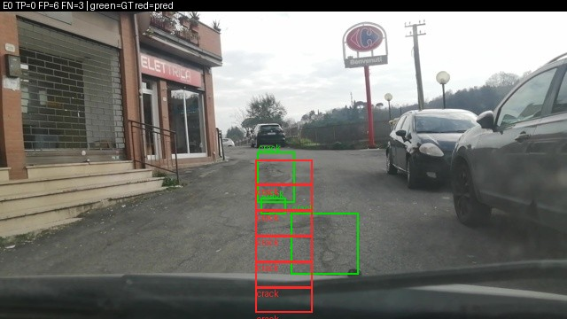

Họ tên: Hoàng Đức Dũng
`dataset_version`: d10-21e4070301

Mọi thí nghiệm chạy trên Kaggle, 1 × Tesla T4 16 GB, QLoRA NF4 (ViT, projector và `lm_head` giữ fp16), 300 bước tối ưu, batch 2 × tích luỹ 4, lr 2e-4, seed 42. Số liệu lấy từ `report/evidence/*.json` (do `scripts/score.py` sinh ra) và `report/logs/*/run.json`; phân tích thêm bằng `python -m d10.analyze` trên `report/predictions/`.

## Bảng tổng hợp (số của bạn, lấy từ `report/evidence/*.json`)

| Mã | Setup | Tham số huấn luyện | VRAM đỉnh (GB) | Phút | F1 | CI95 | FP/ảnh | F1 pothole | F1 crack | F1 manhole |
|---|---|---|---|---|---|---|---|---|---|---|
| E0 | zero-shot | 0 | – | – | 0.077 | 0.055–0.103 | 1.18 | 0.112 | 0.021 | 0.172 |
| E1 | LoRA LLM | 33,030,144 | 6.38 | 42.3 | 0.263 | 0.228–0.304 | 1.35 | 0.148 | 0.190 | 0.545 |
| E2 | + projector | 142,135,296 | 8.07 | 42.9 | 0.304 | 0.269–0.340 | 1.25 | 0.172 | 0.226 | 0.592 |
| E3 | + LoRA ViT | 148,426,752 | 8.25 | 50.9 | **0.421** | 0.378–0.465 | 0.95 | 0.288 | 0.327 | 0.717 |
| E4 | data_size = 10% (142 ảnh), nền E3 | 148,426,752 | 7.70 | 50.5 | 0.285 | 0.249–0.321 | 1.53 | 0.161 | 0.227 | 0.546 |
| E4 | data_size = 100% (1422 ảnh) = E3 | 148,426,752 | 8.25 | 50.9 | 0.421 | 0.378–0.465 | 0.95 | 0.288 | 0.327 | 0.717 |

`parse_valid_rate`: E0 0.942 · E1 1.000 · E2 1.000 · E3 0.997 · E4-10% 1.000. Suy luận: E0 2.42 s/ảnh, E1 2.02 s/ảnh (batch 8).

## 10 câu hỏi (trả lời bằng **số của bạn**, không chép lại tài liệu)

### Câu 1 — Kiến trúc: ViT, projector và LLM của Qwen3-VL-4B có bao nhiêu tham số mỗi khối, và E1/E2/E3 mỗi cái cập nhật khối nào?
Tôi đếm trực tiếp từ header safetensors của checkpoint (`python -m d10.analyze --params`):

| Khối | Tham số | Lưu ở dạng |
|---|---|---|
| ViT (24 block, patch/pos embed) | 306.2M | fp16 |
| Projector `visual.merger` | 27.3M | fp16 |
| Projector `visual.deepstack_merger_list` (3 merger cho lớp 5, 11, 17 của ViT) | 81.8M | fp16 |
| LLM: 36 layer | 3,633.5M | NF4 4-bit |
| LLM: token embedding (dùng chung với `lm_head`) | 389.0M | fp16 |
| **Tổng** | **4,437.8M** | |

Luồng dữ liệu: ảnh 640×360 → ViT → projector gộp 2×2 patch và chiếu sang không gian của LLM, ra **220 token** ảnh → LLM sinh JSON.

- **E1** chỉ cập nhật LoRA (r=16) trên 252 module của LLM (36 layer × 7: q/k/v/o, gate/up/down) = 33.0M tham số, tức 0.74% model. ViT và projector đóng băng.
- **E2** = E1 + huấn luyện **đầy đủ** projector (109.1M, float32) → 142.1M.
- **E3** = E2 + LoRA trên 96 module của ViT (24 block × qkv/proj/linear_fc1/linear_fc2) = thêm 6.3M → 148.4M. Trọng số gốc của ViT vẫn đóng băng, chỉ adapter được học.

### Câu 2 — E0: `parse_valid_rate` bằng bao nhiêu, và hai lỗi phổ biến nhất của model gốc là gì (kèm một ví dụ output thô)?
`parse_valid_rate` = **0.942**: 18/311 output không parse được. Model gốc **không** bọc ```json (0/311) và không vượt thang (0 toạ độ > 1000), tức là nó đã quen thang 0–1000. Lỗi nằm ở hai chỗ khác:

1. **Bịa box sai vị trí, nhất là "crack" phủ cả dải đường.** Trong 404 box E0 dự đoán, 71 box rộng ≥ 900/1000 (gần hết bề ngang ảnh) và 30 box chiếm > 25% khung hình, trong khi box thật có diện tích trung vị chỉ 0.4–2% khung hình. Kết quả: crack có 6 TP / 255 FP (F1 0.021). Ví dụ output thô (ảnh `vlcsnap-00203`):
   `'[{"label": "crack", "bbox_2d": [0, 476, 1000, 1000]}]'`
2. **JSON hỏng do bị cắt.** Cả 18 output hỏng đều dài đúng 413 ký tự: model sinh một "bậc thang" box crack nhỏ nối tiếp nhau (`[485,457,520,478]`, `[520,478,550,500]`, `[550,497,580,520]`, …) cho đến khi chạm `max_new_tokens=256` và bị cắt giữa chừng.

Vì vậy recall của E0 chỉ 0.065: trong 583 box thật, chỉ 40 box được khoanh đúng vị trí (IoU ≥ 0.5, bất kể nhãn).

### Câu 3 — Thang 0–1000: nếu chấm output theo pixel (hoặc ngược lại) thì F1 ra sao và vì sao? Bạn đã kiểm chứng điều này thế nào?
F1 về **đúng 0.000** theo cả hai chiều. Tôi kiểm chứng bằng hai thí nghiệm, chỉ đổi cách chấm, không đổi model:

- Lấy dự đoán của E1 (thang 0–1000) và chấm với `--coord pixel`: F1 từ 0.263 → **0.000**, dù `parse_valid_rate` vẫn 1.000.
- Lấy dự đoán của E3, đổi sang pixel của ảnh 640×360, rồi chấm như thể là 0–1000: F1 **0.000**. Chấm lại đúng với `--coord pixel` thì F1 trở về **0.421**, đúng bằng E3.

Lý do: khi đọc nhầm thang, box bị co hoặc giãn theo hệ số 640/1000 ở trục x và 360/1000 ở trục y (tức 0.64 và 0.36). Box thật chỉ rộng khoảng 46–89 px, nên sau khi co giãn nó trượt hẳn khỏi vị trí đúng, IoU < 0.5 với mọi box thật. Lỗi này **im lặng**: JSON vẫn hợp lệ, chỉ có F1 sập.

Qwen3-VL được tiền huấn luyện grounding theo toạ độ tương đối 0–1000, nên toạ độ không phụ thuộc kích thước ảnh. Điều này quan trọng vì processor resize ảnh 640×360 về lưới 32 px (640×352) trước khi đưa vào ViT, nên "pixel" model nhìn thấy không trùng pixel của ảnh gốc. Tôi cũng kiểm tra phép đổi nhãn: quy ngược JSON 0–1000 về pixel lệch tối đa **0.32 px** so với box YOLO gốc (chỉ do làm tròn).

### Câu 4 — Mask loss: vì sao chỉ tính loss trên phần trả lời? Điều gì xảy ra nếu tính trên cả prompt và token ảnh?
Với một ví dụ train cụ thể, chuỗi đầy đủ có **358 token**, trong đó **220 token ảnh** (`<|image_pad|>`), khoảng 107 token là system/prompt/template, và chỉ **31 token** là đáp án (`[{"label":"manhole","bbox_2d":[105,639,205,689]}]<|im_end|>`). Tôi đặt `labels = -100` cho mọi token thuộc prompt và chỉ giữ 31 token đáp án. Code kiểm tra prompt phải là tiền tố đúng của chuỗi đầy đủ, nếu không thì dừng.

Nếu tính loss trên tất cả:
- **Token ảnh** chỉ là placeholder giống hệt nhau. Bắt model "dự đoán" `<|image_pad|>` thứ 221 từ 220 token trước là việc vô nghĩa, và gradient này ép LLM học lặp ký hiệu thay vì đọc ảnh.
- **Prompt** giống hệt nhau ở mọi ví dụ, nên model chỉ học thuộc câu lệnh. Loss nhanh chóng gần 0 trên phần này.
- Hai phần trên chiếm khoảng 91% số token (327/358), nên loss trung bình bị **pha loãng**: gradient từ 31 token đáp án, phần duy nhất chứa thông tin box, chỉ còn khoảng 1/11. Loss trông giảm đẹp nhưng model học chậm phần cần học, và có nguy cơ quen sinh lại prompt thay vì JSON.

### Câu 5 — Vì sao không thể huấn luyện đầy đủ projector nếu ViT bị lượng tử hoá 4-bit, và bạn đã xử lý thế nào? Vì sao projector phải ở float32?
Projector (`visual.merger`, `visual.deepstack_merger_list`) nằm trong `model.visual`. Nếu ViT bị lượng tử hoá, các lớp Linear của projector thành `Linear4bit`. Trọng số khi đó là các byte `uint8` đóng gói 2 giá trị NF4/byte, kèm hằng số lượng tử hoá. Đó không phải tensor số thực liên tục, nên không thể nhận gradient và cập nhật trực tiếp. Chỉ có thể gắn adapter LoRA lên trên, không thể "mở đầy đủ" như E2/E3 yêu cầu.

Tôi gặp đúng lỗi này. Với `llm_int8_skip_modules=["visual", "lm_head"]` như pseudo code, transformers 5 vẫn lượng tử hoá ViT, vì nó so pattern với **đầu** hoặc **đuôi** tên module đầy đủ, mà tên thật là `model.visual.…`. Hai dấu hiệu:
- Projector đếm được **54.6M** thay vì 109.1M, vì `numel()` của tensor 4-bit chỉ bằng một nửa số trọng số.
- Huấn luyện E2 báo lỗi `Attempting to unscale FP16 gradients`.

Cách xử lý: thêm pattern `"model.visual"`, và sau khi nạp model thì **dừng ngay** nếu còn tensor nào của ViT hoặc `lm_head` không phải số thực. Sau khi sửa: 252 module `Linear4bit` (chỉ trong LLM), projector đủ 109,105,152 tham số.

Projector phải ở **float32** vì hai lý do:
1. `GradScaler` của fp16 từ chối unscale gradient fp16.
2. fp16 chỉ có 10 bit mantissa: với trọng số cỡ 0.05, khoảng cách giữa hai số fp16 liền kề khoảng 3e-5. Một bước cập nhật lr × grad (lr ≤ 2e-4, gradient đã clip) thường nhỏ hơn nửa khoảng cách đó nên bị **làm tròn mất**, và trọng số gần như không đổi.

Vì vậy mọi tham số được tối ưu (LoRA + projector) đều để float32. Phần đóng băng vẫn giữ fp16 hoặc 4-bit, và forward chạy dưới autocast fp16.

### Câu 6 — Split theo phiên quay: vì sao chia ngẫu nhiên sẽ cho F1 cao giả? Số ảnh và số box từng lớp ở mỗi split là bao nhiêu?
| Split | Phiên | Ảnh | pothole | crack | manhole |
|---|---|---|---|---|---|
| train | 13 | 1,422 | 1,074 | 1,750 | 691 |
| val | 2 | 276 | 66 | 470 | 103 |
| test | 3 | 311 | 121 | 299 | 163 |

Không phiên nào xuất hiện ở hai split (đã kiểm tra trong notebook).

Ảnh là các frame cắt từ video dashcam: hai frame liền nhau (ví dụ `…23h30m29s192` và `…23h30m29s418`, cách nhau 0.2 giây) gần như trùng nhau, cùng ổ gà, cùng ánh sáng. Nếu chia ngẫu nhiên theo ảnh, hầu hết ảnh test sẽ có một "bản sao" gần giống trong train. Model chỉ cần **nhớ** box của bản sao là đạt F1 cao, và con số đó đo khả năng học thuộc chứ không phải khả năng tổng quát sang con đường mới.

Kết quả của tôi cho thấy học thuộc không tự chuyển thành tổng quát: ở E4, model 10% dữ liệu đưa loss train về **0.015** (gần như thuộc lòng 142 ảnh), nhưng F1 trên các phiên test chưa từng thấy chỉ **0.285**. Với split ngẫu nhiên, khoảng cách này sẽ bị che mất. Chia theo phiên cũng làm phân bố lớp lệch: val chỉ có 66 pothole. Vì thế tôi đọc F1 từng lớp chứ không chỉ F1 tổng.

### Câu 7 — So sánh E1/E2/E3: mở projector và LoRA trên ViT có đáng không (F1, CI95, VRAM, thời gian)?
| | ΔF1 (bootstrap ghép cặp, CI95) | ΔVRAM | ΔThời gian | Δtham số |
|---|---|---|---|---|
| E2 − E1 (mở projector) | +0.040 [+0.007, +0.073] | +1.69 GB | +0.6 phút | +109.1M |
| E3 − E2 (LoRA ViT) | **+0.117 [+0.074, +0.159]** | +0.18 GB | +8.0 phút | +6.3M |
| E3 − E1 | +0.158 [+0.116, +0.198] | +1.87 GB | +8.6 phút | +115.4M |

- **Mở projector** có lợi nhưng nhỏ. Nó tốn VRAM nhiều nhất trong ba bước: 109M tham số float32 cùng hai trạng thái AdamW và gradient khoảng 1.7 GB, khớp với +1.69 GB đo được. Thời gian gần như không đổi, vì gradient chỉ phải đi tới projector, không đi sâu vào ViT.
- **LoRA trên ViT** là bước đáng giá nhất: chỉ thêm 6.3M tham số và 0.18 GB, nhưng F1 tăng mạnh nhất, và cả ba lớp đều tăng (pothole 0.172 → 0.288, crack 0.226 → 0.327, manhole 0.592 → 0.717). FP/ảnh giảm từ 1.25 xuống 0.95. Cái giá là thời gian (+19%), vì backward phải đi qua cả 24 block ViT với gradient checkpointing. Lý do hợp lý: box rất nhỏ (pothole trung vị 46×22 px), nên đặc trưng ViT gốc học cho ảnh tự nhiên chưa đủ chi tiết, cần chỉnh chính bộ mã hoá ảnh.
- Kết luận: E3 là setup tốt nhất và cũng hiệu quả nhất trên mỗi GB VRAM. Peak 8.25 GB vẫn vừa T4 với batch 2.

### Câu 8 — Tập test có 311 ảnh: khoảng tin cậy rộng thế nào, và điều đó giới hạn kết luận so sánh các setup ra sao?
CI95 bootstrap của F1 rộng khoảng **±0.04**: E1 0.228–0.304 (rộng 0.076), E2 0.269–0.340 (0.071), E3 0.378–0.465 (0.087). Hệ quả:

- **E1 > E0** và **E3 > E2** rất chắc: CI không chồng nhau, và bootstrap ghép cặp cho P(Δ ≤ 0) = 0.000.
- **E2 > E1** thì yếu: hai CI riêng **chồng nhau** (0.269–0.340 so với 0.228–0.304). Chỉ khi bootstrap **ghép cặp** trên cùng 311 ảnh (hai model gặp cùng ảnh khó và ảnh dễ) thì Δ = +0.040 [+0.007, +0.073] mới vừa khác 0. Tôi chỉ dám nói "mở projector có lẽ giúp một chút".
- F1 **từng lớp** còn kém chắc chắn hơn, vì mỗi lớp chỉ có 121–299 box. Ví dụ pothole E1 0.148 so với E2 0.172 là khác biệt 4 TP (16 → 20).

Các CI này vẫn **lạc quan** vì ba lý do:
1. Bootstrap lấy mẫu từng ảnh, nhưng 311 ảnh test chỉ đến từ **3 phiên quay**, và các frame cùng phiên tương quan mạnh với nhau. Nguồn biến thiên thật là "con đường nào", tức chỉ có 3 mẫu, nên CI thật rộng hơn.
2. Mỗi setup chỉ chạy **một seed**, nên nhiễu huấn luyện chưa được đo.
3. Tôi chọn setup tốt nhất (E3) cho E4 dựa trên F1 test, vì vậy F1 0.421 có thể hơi lạc quan.

### Câu 9 — Phân tích lỗi theo lớp: lớp nào kém nhất và vì sao (kích thước box, số mẫu, ngữ nghĩa)? Kèm ảnh minh hoạ.
**Pothole kém nhất** ở mọi setup đã huấn luyện (E3: P 0.317, R 0.264, F1 0.288). Manhole tốt nhất (E3: P 0.819, F1 0.717), crack ở giữa (F1 0.327).

| Lớp (test) | Box | Diện tích trung vị | w × h trung vị | Số box train |
|---|---|---|---|---|
| pothole | 121 | 0.42% | 46 × 22 px | 1,074 |
| crack | 299 | 1.98% | 89 × 55 px | 1,750 |
| manhole | 163 | 0.67% | 63 × 24 px | 691 |

- **Không phải do thiếu mẫu**: pothole có 1,074 box train, nhiều hơn manhole (691), nhưng F1 thấp hơn nhiều.
- **Kích thước:** pothole là box nhỏ nhất. 46×22 px sau khi ViT gộp patch chỉ còn khoảng 1–2 token ảnh, nên lệch vài pixel là IoU đã dưới 0.5.
- **Ngữ nghĩa mơ hồ:** ổ gà và vết nứt lớn trông rất giống nhau. Trong 267 box thật mà E3 khoanh đúng vị trí, 33 box sai nhãn, nhiều nhất là pothole bị gọi thành crack (12). Ngược lại, nắp cống có hình dạng đều và màu kim loại khác hẳn mặt đường, nên ít bị nhầm.
- **Crack** khó vì ranh giới: một vết nứt dài có thể được gán nhãn thành một box lớn hoặc nhiều box nhỏ. Recall của E3 khi nới IoU: 0.53 ở IoU 0.3, 0.40 ở IoU 0.5, 0.20 ở IoU 0.7. Nghĩa là model thường **thấy đúng chỗ nhưng khoanh lệch**, lỗi chủ yếu là định vị chứ không phải bỏ sót.

Ảnh minh hoạ (xanh lá = nhãn đúng, đỏ = dự đoán; `report/figures/`):

| Ảnh | Chú thích |
|---|---|
|  | **E1 đúng** (TP=2, FP=0, FN=0): hai nắp cống trên làn đường, box đỏ gần như trùng box xanh. Manhole là lớp dễ nhất. |
|  | **E1 sai** (TP=0, FP=11, FN=7): mặt đường có cụm ổ gà và vết nứt chồng lấn nhau. Model khoanh đúng vùng hư hại nhưng tách hoặc gộp box khác cách người gán nhãn, và nhầm pothole với crack. |
|  | **E1 sai** (TP=0, FP=7, FN=5): frame kế tiếp của cùng cảnh (cách 0.2 s). Lỗi lặp lại gần như y hệt, cho thấy các frame cùng phiên tương quan mạnh (xem câu 8). |
|  | **E0 đúng** (TP=1, FP=0, FN=0): một vết nứt dọc mép đường, rõ và tách biệt. Model gốc khoanh đúng, cho thấy nó đã biết thang 0–1000 trước khi finetune. |
|  | **E0 sai** (TP=0, FP=7, FN=3): lỗi đặc trưng của model gốc là xếp chồng nhiều dải "crack" phủ hết bề ngang ảnh, không trùng vết nứt thật nào. |
|  | **E0 sai** (TP=0, FP=6, FN=3): kiểu lỗi "bậc thang" của câu 2: một cột box "crack" xếp liền nhau từ xa đến mũi xe, không box nào trùng vết nứt thật. Kiểu lỗi này đẩy FP/ảnh của E0 lên 1.18, dù cả tập test chỉ có 38 TP. |

Đường loss của E1–E3: `report/figures/loss.png`.

### Câu 10 — E4: bạn đổi biến nào, kết quả thế nào, và kết luận có đáng tin không?
Tôi đổi **đúng một biến**: `data_size`, giữ nguyên mọi thứ khác của setup tốt nhất (E3), gồm 300 bước, batch 2 × 4, lr và seed.

| | Ảnh train | Loss cuối | F1 | CI95 | FP/ảnh |
|---|---|---|---|---|---|
| 10% | 142 | **0.015** | 0.285 | 0.249–0.321 | 1.53 |
| 100% (= E3) | 1,422 | 0.505 | 0.421 | 0.378–0.465 | 0.95 |

- Dùng đủ dữ liệu tăng F1 **+0.136**, CI95 ghép cặp [+0.094, +0.179]. Hai CI riêng không chồng nhau, nên khác biệt này đáng tin. Cả ba lớp đều giảm khi chỉ còn 10%, và FP/ảnh tăng 61%.
- Nguyên nhân là **overfit**: với 300 bước × 8 ảnh = 2,400 lượt, mỗi ảnh trong 142 ảnh được xem khoảng 17 lần, so với khoảng 1.7 lần khi dùng đủ dữ liệu. Loss train giảm đều từ 0.44 (bước 100) xuống 0.18 (bước 200) rồi 0.015 (bước 300): model thuộc lòng đáp án nhưng không tổng quát sang phiên mới.
- Đáng chú ý: E3 với 10% dữ liệu vẫn **ngang** E1 với 100% dữ liệu (Δ = +0.022, CI [−0.020, +0.060], không khác 0). Với tập test này, cập nhật thêm phần thị giác (projector + LoRA ViT) có giá trị tương đương việc có gấp 10 lần dữ liệu cho một model chỉ chỉnh LLM.

Giới hạn của kết luận:
1. Giữ cố định số bước nghĩa là bản 10% chạy nhiều epoch hơn, nên đây là so sánh "cùng ngân sách tính toán", không tách được hiệu ứng số epoch.
2. Chỉ một seed và một tập con 10% ngẫu nhiên.
3. Chỉ có 3 phiên test (câu 8).

Hướng kết luận (nhiều dữ liệu hơn thì tốt hơn rõ rệt) là chắc chắn. Độ lớn chính xác (+0.136) thì không nên tin tới chữ số thứ ba.

## Nhìn lại

- **Lỗi mà công cụ chấm không bắt được:** pattern `"visual"` trong `llm_int8_skip_modules` không có tác dụng trên transformers 5, nên ViT bị lượng tử hoá **mà không có cảnh báo nào**. E0/E1 vẫn chạy và vẫn ra F1, chỉ đến E2 mới lộ lỗi. Tôi thêm bước kiểm tra kiểu dữ liệu sau khi nạp model để chặn lỗi này ngay từ đầu.
- **Môi trường:** `torchao` 0.10 cài sẵn trên Colab/Kaggle khiến `peft` báo lỗi khi gắn LoRA lên `nn.Linear` thường, nên chỉ E3 gặp. Trên Colab tôi còn gặp OOM giả ở E3: model của một lần chạy lỗi trước vẫn bị traceback giữ trên GPU (5.15 GB). Trên Kaggle, chạy mỗi thí nghiệm trong tiến trình riêng thì E3 chỉ cần 8.25 GB.
- **Dữ liệu:** 49 box có mép vượt khung ảnh (đã kẹp vào [0, 1000]) và 1 box crack trong train có kích thước 0. Box độ rộng 0 sẽ khiến `parse_output` coi **cả** đáp án là hỏng, nên tôi nới box thoái hoá thành rộng 1 đơn vị trước khi dạy model.
- **Output dài:** E3 có 1/311 output bị cắt (887 ký tự, dừng giữa một box). `parse_valid_rate` chỉ cho biết có hỏng, không cho biết vì sao. Nên theo dõi thêm tỉ lệ output chạm `max_new_tokens`.
- **Điều tôi chưa chắc:** CI bootstrap theo ảnh có thể quá hẹp vì test chỉ có 3 phiên. Một bootstrap theo phiên, hoặc thêm vài seed, sẽ cho câu trả lời trung thực hơn về việc E2 có thật sự hơn E1 hay không.
